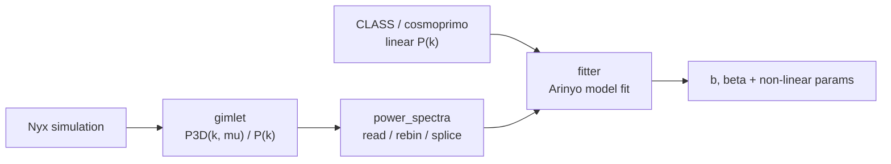

# lyapower

**lyapower** fits the **three-dimensional flux power spectrum P₃D(k, μ)** of the
Lyman-alpha forest measured from **Nyx** hydrodynamical simulations
(post-processed by the [gimlet](https://github.com/DrJRyan/gimlet) code),
implementing the non-linear models of **Arinyo-i-Prats et al. 2015** and the
**splicing** technique that combines simulation boxes of different resolution.

It lets you:

- **read** gimlet / genpk / ascii power-spectrum files as
  `MatterPowerSpectrum` / `FluxPowerSpectrum` objects, rebin and plot them
  ([`power_spectra`](api/power_spectra.md));
- **compute** the linear matter power spectrum with CLASS or cosmoprimo
  ([`CLASS`](api/CLASS.md));
- **fit** the flux P₃D with the Arinyo non-linear models (`D0`, `D1`, and BAO
  variants) using iminuit ([`fitter`](api/fitter.md));
- **splice** low- and high-resolution boxes into a single P(k) / P(k, μ)
  ([`power_spectra`](api/power_spectra.md)).

## Where lyapower sits

lyapower is a **Pillar 2** (estimators) analysis package: it turns simulated
Lyman-alpha flux fields into a fitted 3D flux power spectrum and its Arinyo
model parameters.



## Quick look

```python
from lyapower import power_spectra

flux = power_spectra.FluxPowerSpectrum.init_3D_from_gimlet(
    "data_example/plt00216z_flux_pkmu.txt", type_file="txt", kmu=True,
)
k, mu = flux.k_array          # stacked [k, mu], in h/Mpc and mu = k_par/k
p = flux.power_array
```

## Next steps

- [Getting started](getting-started.md) — install and read a first spectrum.
- [Analysis pipeline](pipeline.md) — from simulation to fitted P₃D.
- [API reference](api/index.md) — every module, class and function.

!!! note "Conventions"
    Wavenumbers `k` are in h/Mpc (see
    [`change_k_normalization`](api/power_spectra.md) for the 1/Mpc case),
    `mu = k_parallel / k`, and power spectra are `P(k)` (1D) or `P(k, μ)` (3D,
    with `k_array` stacked as `[k, mu]`).
