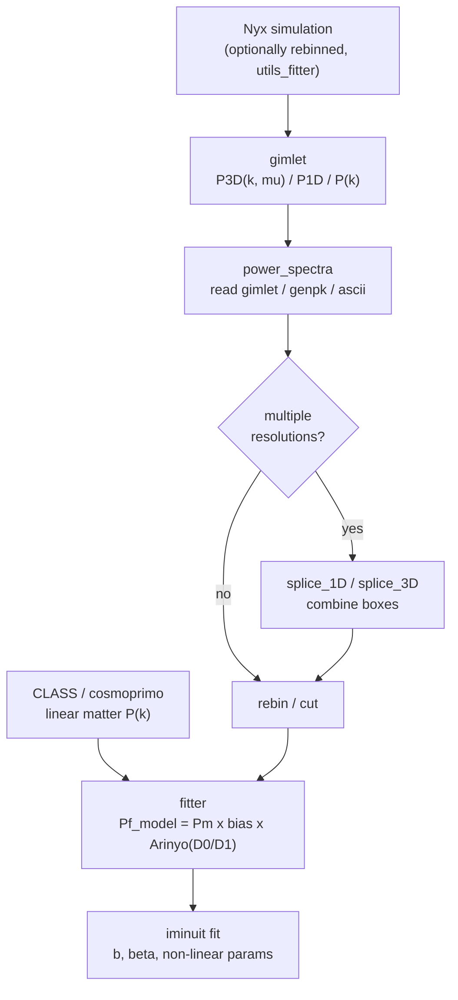

# Analysis pipeline

lyapower turns the Lyman-alpha flux field of a **Nyx** simulation into a fitted
**3D flux power spectrum** and its Arinyo-i-Prats et al. 2015 model parameters.

## Stages

| Stage | Module | What it does |
|---|---|---|
| **(Pre) rebinning** | [`utils_fitter`](api/utils_fitter.md) | Optionally downsample a Nyx/HDF5 field (e.g. optical depth → transmitted flux) slice by slice before measuring the power. |
| **Read** | [`power_spectra`](api/power_spectra.md) | Load gimlet / genpk / ascii files into `MatterPowerSpectrum` / `FluxPowerSpectrum` objects (P(k) or P(k, μ)). |
| **Splice** | [`power_spectra`](api/power_spectra.md) | Combine low- and high-resolution boxes into a single spectrum (`splice_1D`, `splice_3D`) to extend the dynamic range. |
| **Rebin / cut** | [`power_spectra`](api/power_spectra.md) | Rebin in k (or k, μ) and restrict the fitted range (`rebin_arrays`, `rebin_2d_arrays`, `cut_extremum`). |
| **Linear P(k)** | [`CLASS`](api/CLASS.md) | Compute the linear matter power spectrum with CLASS (`MyClass`) or cosmoprimo (`CosmoprimoInterface`), with a no-wiggle option for BAO. |
| **Model + fit** | [`fitter`](api/fitter.md) | Build the flux model `Pf_model` (linear `Pm` × bias/RSD × Arinyo non-linear `D0`/`D1`) and fit `b`, `β` and the non-linear parameters with iminuit. |

## The Arinyo model

The measured flux power spectrum is modelled as the linear matter power spectrum
times a bias/RSD factor and a non-linear correction:

- `D0` — the Arinyo non-linear term parameterised by
  `(k_nl, a_nl, k_p, a_p, k_v0, a_v0, k_v1, a_v1)`;
- `D1` — an alternative parameterisation
  `(q_1, q_2, k_v, a_v, b_v, k_p)`;
- **BAO variants** add broadening parameters `S_p`, `S_t` for the
  parallel / transverse BAO smoothing.

The cost functions and Minuit drivers live in
[`fitter`](api/fitter.md) (`custom_least_squares*`, `cost_function`,
`run_minuit`, `fitter_k_mu`).

## Conventions

- Wavenumber `k` in **h/Mpc** (`change_k_normalization` converts to/from
  1/Mpc); `mu = k_parallel / k`.
- Power spectra are stored as `P(k)` (1D) or `P(k, μ)` (3D, with `k_array`
  stacked as `[k, mu]`).
- `b` and `beta` are the linear bias and redshift-space-distortion parameter.
